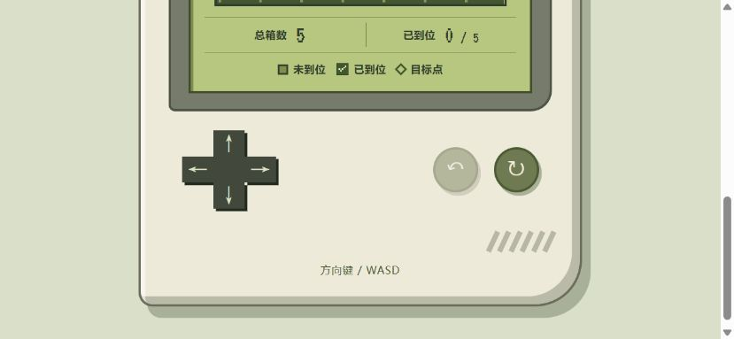
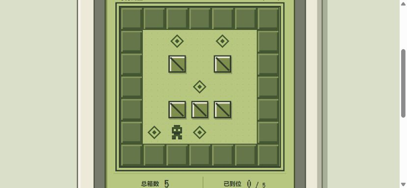

# 07_Skill审查与修复

2026-11-13（Asia/Shanghai）。审查基线：`51b2239`。本轮修复焦点不可见及焦点落在屏幕外的问题，保留「口袋星期天」的布局、图标按钮、关卡和计数规则。其余发现列为后续项，不把本次审查等同于完整无障碍认证。

## 技能来源与版本

已通过 Codex `skill-installer` 安装 [vercel-labs/agent-skills 的 web-design-guidelines](https://github.com/vercel-labs/agent-skills/tree/1a2c79d4e6c4a2283dc2c614b6538cbe1ed5ca62/skills/web-design-guidelines)，作者 vercel，技能声明版本 **1.0.0**，固定仓库提交 **1a2c79d4e6c4a2283dc2c614b6538cbe1ed5ca62**。

安装位置：`C:/Users/yonhu/.codex/skills/web-design-guidelines/SKILL.md`。下一轮可作为已安装技能调用；本轮已读取并使用。安装器最初调用系统 Python 别名失败，改用 Codex 自带 Python 后安装成功；未覆盖已有技能。

按技能要求，本轮重新读取了在线规范；该规范另属 `vercel-labs/web-interface-guidelines`，固定版本为 **434b7f91364665f2f733b310ec54809bf8f37937**，见 [command.md](https://github.com/vercel-labs/web-interface-guidelines/blob/434b7f91364665f2f733b310ec54809bf8f37937/command.md)。技能与规范分别记录，避免把技能版本误当成全部规则的版本。安装文件与规范的 SHA-256 见 [skill-source.json](skill-source.json)。

## 发现：位置、影响与处置

下列行号对应本轮源码；HTML 是生成产物，同类问题定位到生成器，不重复列出嵌入后的每份 CSS/JS。P1/P2/P3 是本项目修复优先级。

### src/pocket.css / src/runtime.js

- **P1，已修复** — `src/pocket.css:33`、`src/runtime.js:77`：旧 CSS 取消棋盘与通关标题的焦点轮廓；JS 又以 `preventScroll: true` 转移焦点。短窗口里从下方按键区重开后，键盘实际控制的棋盘可能位于屏幕外。影响撤销、重开、通关和查看棋盘的连续键盘操作。新增 `:focus-visible` 像素边框与 12px 滚动留白，并统一通过 `focusRegion()` 就近、即时滚动到目标。此问题会直接中断操作定位，优先于装饰和触区改进。
- **P2，遗留** — `src/pocket.css:40`、`src/pocket.css:202`：掌机的纵向间距主要按固定尺寸设计。实测 1366×768、844×390 时文档约 973px 高，棋盘与下方按键不能始终同屏；当前可滚动到达，焦点返回已修复，但仍需后续设计紧凑的短窗口布局。属于实测可用性观察，不将正常纵向滚动认定为横向溢出。
- **P2，遗留** — `src/pocket.css:203`：十字键每键为 36×30px，手机连续点按较紧凑；建议之后增大触区并保持十字外观。属于触屏舒适度建议，本轮没有将其表述为违反某个未实测的 WCAG 条款。
- **P2，遗留** — `src/pocket.css:242`、`src/pocket.css:244`：通关页“再玩一次”“查看棋盘”和“查看成绩”没有专用 hover/active 样式，鼠标反馈弱于下方十字键。按钮仍可点击、可 Tab 聚焦，功能检查通过；后续补齐一致的交互状态。

### scripts/build.mjs

- **P3，遗留** — `scripts/build.mjs:65`：星星固定显示为“三星评价”，没有评分规则。可能让玩家把装饰当成根据成绩计算的评级；建议未来改为明确装饰或在定义评分规则后接入真实评级。
- **P3，遗留** — `scripts/build.mjs:89`：缺少与背景匹配的 `theme-color`，移动浏览器外围颜色可能不一致；不影响游戏操作。
- **P3，遗留** — `scripts/build.mjs:97`：未提供跳至主要内容的链接。页面很短且没有长导航，当前 Tab 可直接到操作键，因此优先级较低；未来扩展页面结构时补齐。

### src/game.mjs / src/boards.mjs / 生成的 HTML

本次范围内未发现阻断玩法的规则问题。7×7 地形、5 箱 5 目标、阻挡判断、撤销和计数测试通过。`index.html` 保留内嵌字体、样式、图形与脚本；静态参考页禁用按钮为既定用途；`complete.html` 转到实际结果视图，没有使用固定示例分数冒充成绩。

## 复测与改善证据

使用 Codex 内置浏览器实际打开 `http://127.0.0.1:4173/`，通过真实键盘事件与按钮点击操作。没有把源码阅读或规则单测代替 UI 验证。原始数据见 [browser-validation.json](browser-validation.json)。

| 检查 | 结果 |
| --- | --- |
| 844×390 键盘重开后的焦点 | 修复前棋盘顶端约 −328.67px、底端 7.33px，轮廓为 none；修复后顶端 12px、底端 348px，轮廓为 solid，棋盘完整可见 |
| Tab 顺序 | 上、左、右、下、重开；初始禁用的撤销被跳过，所有可聚焦按钮有可见焦点，均进入视口 |
| 窗口适配 | 320×740、390×844、768×1024、1366×768、844×390；scrollWidth 均等于 clientWidth，无横向溢出；允许必要的纵向滚动 |
| 移动 | W 与鼠标向上均实际推动一次，步数与推动次数各增加 1 |
| 受阻 | S 撞墙、鼠标向右顶住相邻箱子、↑ 推箱顶墙；前后角色、箱子、步数与推动次数一致，出现“Oops推不动了” |
| 撤销与重开 | 键盘 Z/R 和屏幕图标操作均恢复相应位置与计数；重开归零 |
| 通关 | 用方向键实际完成 28 步、7 次推动，5/5 到位，显示真实结果，方向键禁用 |
| 结果页焦点往返 | 通关标题有焦点框且在短窗口内；查看棋盘、查看成绩、撤销通关、再次通关和再玩一次均正确 |
| 控制台 | 本轮捕获到的 error 日志为 0 |
| 规则测试 | `node --test tests/game.test.mjs`：10/10 通过 |
| 构建与离线依赖 | `node scripts/build.mjs` 成功；静态检查无外部 src/href 资产，字体与运行脚本仍内嵌 |

修复前后截图：

其他截图为 [手机受阻提示](blocked-mobile.jpg)、[通关标题焦点](win-focus.jpg)、[当前主界面](final-page.jpg)。

## 达成项与验证边界

本轮完成技能安装和版本记录、HTML/CSS/JS 审查、一项最高优先级焦点问题修复，以及用户要求的窗口、焦点、移动、受阻、撤销、重开和通关实测。图标按钮具有无障碍名称，使用原生 button；状态播报有 polite live region；动画使用 transform 并支持减少动态效果；保留横排中文和像素风。未使用外部资源或引入新框架。

表单、媒体字幕、服务器水合、远程图片加载和长列表等规则不适用于当前单页小游戏。低优先级发现没有批量修改，以便本轮变化可复核。

浏览器 URL 策略拒绝 `file://` 协议，所以本轮没有重新完成“直接双击文件”的浏览器离线测试，也没有绕过策略改用其他浏览器通道；本轮 UI 结果来自本地 HTTP。上一阶段的离线测试记录仍在历史提交中。未测试实体手机、真实屏幕阅读器、所有操作系统或浏览器，不能据此宣称全面兼容或完整无障碍达标。
